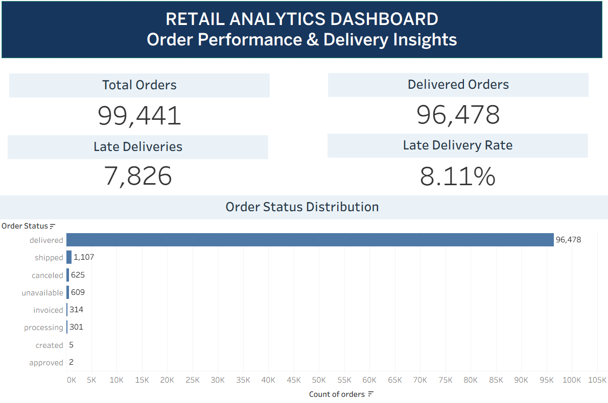

# Retail Analytics — Project Findings

## 1. Project Objective

Analyze Brazilian e-commerce order data to understand order-status distribution and delivery performance.

## 2. Dataset Overview

- Total order records: 99,441
- Unique order IDs: 99,441
- Source: Brazilian E-Commerce Public Dataset by Olist

## 3. Key Findings

| Metric | Result |
|---|---:|
| Total orders | 99,441 |
| Delivered orders | 96,478 |
| Delivered share of all orders | 97.02% |
| Average delivery duration | 12.56 days |
| Late delivered orders | 7,826 |
| Late-delivery rate | 8.11% |
| Average delivery delay | -11.18 days |

## 4. Interpretation

- Delivered orders account for 97.02% of all recorded orders.
- The average delivery duration among orders with valid delivery timestamps is approximately 12.56 days.
- Approximately 8.11% of delivered orders with delay information were delivered after the estimated date, based on the project's SQL KPI calculation.
- The negative average delivery delay indicates that actual delivery occurred earlier than the estimated date on average.

## 5. Data Quality

- The dataset contains 99,441 unique order IDs.
- Some records have missing delivery timestamps.
- Missing delivery durations were preserved as missing values rather than replaced with zero.
- Delivery delay is calculated using actual delivery date minus estimated delivery date.

## 6. Tools Used

Python, pandas, MySQL, SQL, and Tableau.

## 7. Recommended Next Analysis

Extend the project to include sales revenue, payment methods, product categories, customer geography, and monthly trends.

